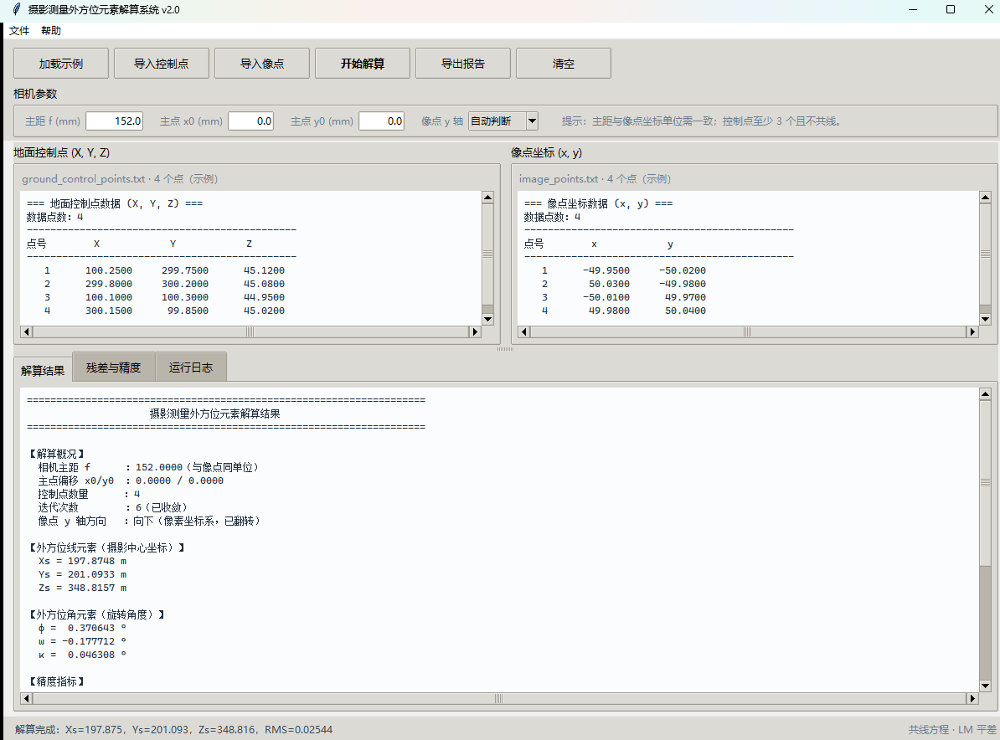
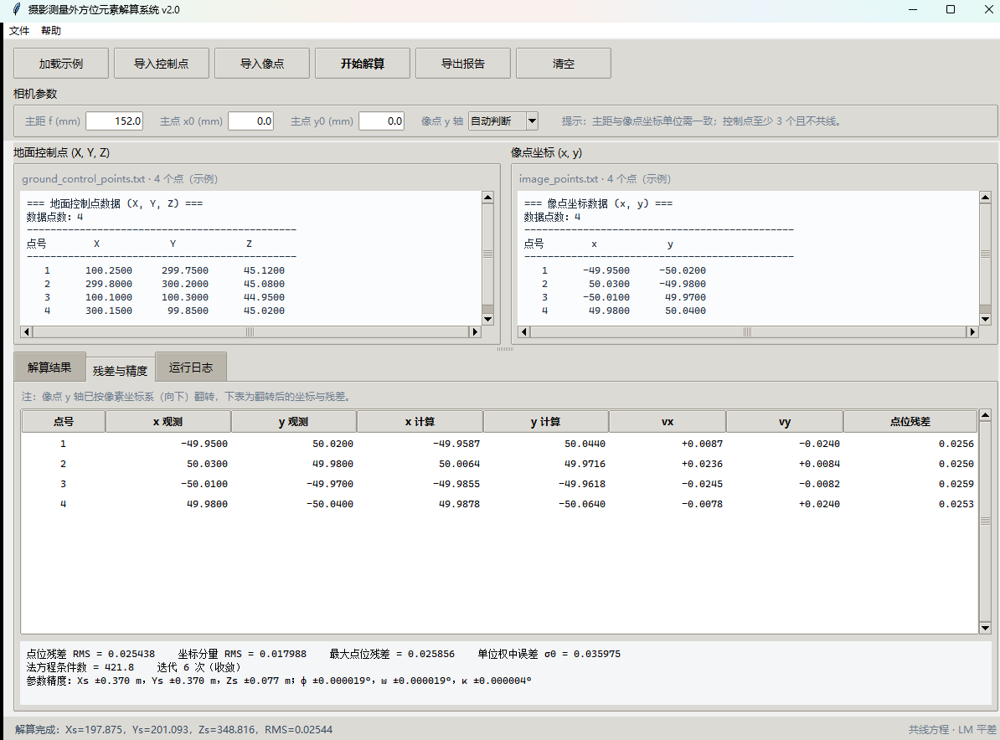

# 摄影测量外方位元素解算系统

[](https://github.com/zbf1154-ctrl/Photogrammetry/actions/workflows/ci.yml)
[](https://www.python.org/)
[](LICENSE)
[](https://numpy.org/)

基于 **共线条件方程 + Levenberg–Marquardt 平差** 的单张影像外方位元素解算工具。
提供 Tkinter 图形界面与可编程 Python API，适用于摄影测量教学、近景摄影测量与小型航测数据快速处理。



## 功能特性

- **严密解算**：解析偏导计算系数矩阵，任意倾角下均严密，不再使用近似系数。
- **稳健初值**：由地面点与像点的二维相似变换估计比例尺、旋角与摄影中心平面位置，
  彻底解决旧版“以控制点重心上方 1000 m 作为初值”导致的迭代发散问题。
- **LM 阻尼迭代 + 多组初值**：兼顾收敛速度与稳健性，自动选取残差最小的解。
- **像点 y 轴自动识别**：自动判断像素坐标系（y 轴向下）造成的镜像并翻转，报告注明处理方式。
- **精度评定**：输出单位权中误差、参数 1σ 精度、残差 RMS、法方程条件数与几何告警。
- **逐点残差**：表格展示观测值、计算值、vx/vy 与点位残差，超限点自动标红。
- **完整报告导出**：一键导出包含旋转矩阵、精度与残差表的 UTF-8 文本报告。
- **数据兼容**：TXT/CSV，空格/制表符/逗号/分号分隔，支持 `#` 注释、UTF-8/UTF-16/GBK 编码。
- **工程质量**：核心算法与界面解耦，34 个单元测试，GitHub Actions 持续集成。



## 算法说明

### 共线条件方程

设地面点 $(X, Y, Z)$、摄影中心 $(X_s, Y_s, Z_s)$，旋转矩阵

$$
R = \begin{bmatrix}
a_1 & b_1 & c_1 \\
a_2 & b_2 & c_2 \\
a_3 & b_3 & c_3
\end{bmatrix}
$$

则

$$
\begin{aligned}
x - x_0 &= -f\,\frac{a_1(X-X_s) + b_1(Y-Y_s) + c_1(Z-Z_s)}
                    {a_3(X-X_s) + b_3(Y-Y_s) + c_3(Z-Z_s)} \\[4pt]
y - y_0 &= -f\,\frac{a_2(X-X_s) + b_2(Y-Y_s) + c_2(Z-Z_s)}
                    {a_3(X-X_s) + b_3(Y-Y_s) + c_3(Z-Z_s)}
\end{aligned}
$$

其中 $f$ 为主距，$(x_0, y_0)$ 为主点偏移，三个角元素 $\varphi,\omega,\kappa$
分别对应航向角、旁向角与像片旋角。

### 初值与平差

1. 用最小二乘拟合 $\begin{bmatrix}x\\y\end{bmatrix} \approx A\begin{bmatrix}X\\Y\end{bmatrix} + t$，
   由 $\det A$ 的符号判断像点 y 轴方向；比例尺 $s=\sqrt{|\det A|}$，航高 $H=f/s$。
2. 由 $A$ 提取 $\kappa$ 与摄影中心平面位置，取 $Z_s = \overline{Z} + H$ 作为初值。
3. 对每对观测值线性化 $A\,\delta = L$，采用 Levenberg–Marquardt 阻尼法求解：

$$
\delta = (A^\mathsf{T}A + \lambda\,\mathrm{diag}(A^\mathsf{T}A))^{-1} A^\mathsf{T}L
$$

4. 以多组初值分别迭代，取残差平方和最小且物理上合理的解。
5. 精度评定：$m_0 = \sqrt{v^\mathsf{T}v/(2n-6)}$，协方差 $\Sigma = m_0^2 (A^\mathsf{T}A)^{-1}$。

## 快速开始

```bash
git clone https://github.com/zbf1154-ctrl/Photogrammetry.git
cd Photogrammetry

python -m venv .venv
# Windows
.venv\Scripts\activate
# macOS / Linux
# source .venv/bin/activate

pip install -r requirements.txt
python main.py
```

也可以安装为软件包，使用命令行入口：

```bash
pip install -e .
photogrammetry-gui
```

启动后点击 **加载示例** → **开始解算** 即可查看完整流程；`python main.py --demo` 可直接载入示例并解算。

### 作为库调用

```python
import numpy as np
from photogrammetry import solve_exterior_orientation

ground = np.loadtxt("examples/ground_control_points.txt")   # n×3，单位 m
image = np.loadtxt("examples/image_points.txt")             # n×2，单位 mm

solution = solve_exterior_orientation(ground, image, f=152.0)

print(solution.params_deg)          # [Xs, Ys, Zs, phi, omega, kappa(°)]
print(solution.rms, solution.sigma0)
print(solution.std)                 # 参数 1σ 精度
print(solution.warnings)            # 几何质量提示
```

## 数据格式

两个文件按行一一对应，点数必须相同，且至少需要 3 个不共线的控制点。

**地面控制点**（`examples/ground_control_points.txt`，单位通常为米）：

```text
# X        Y        Z
100.25     299.75   45.12
299.80     300.20   45.08
100.10     100.30   44.95
300.15      99.85   45.02
```

**像点坐标**（`examples/image_points.txt`，单位需与主距一致，通常为毫米）：

```text
# x         y
-49.95     -50.02
 50.03     -49.98
-50.01      49.97
 49.98      50.04
```

- 分隔符：空格、制表符、逗号、分号均可；
- 注释：`#` 之后的整行或行尾内容会被忽略；
- 编码：自动识别 UTF-8（含 BOM）、UTF-16、GBK；
- 像点 y 轴：默认自动判断，也可在界面中强制指定“向上/向下”。

## 界面使用

1. **导入数据**：点击“导入控制点 / 导入像点”，或按 `Ctrl+O` / `Ctrl+I`；也可用“加载示例”一键体验。
2. **设置相机参数**：输入主距 `f`（mm）、主点偏移 `x0 / y0`（mm），选择像点 y 轴方向。
3. **解算**：点击“开始解算”（`F5`）。结果页显示 6 个外方位元素与精度指标；
   “残差与精度”页展示逐点残差；“运行日志”页记录每一步操作与告警。
4. **导出**：点击“导出报告”（`Ctrl+S`），生成带时间戳的 UTF-8 文本报告。
5. **清空**：`Ctrl+L` 重置全部数据与缓存。

### 示例结果

示例数据（4 个控制点，$f = 152$ mm）的解算结果：

| 参数 | 结果 |
| --- | --- |
| $X_s$ | 197.8748 m |
| $Y_s$ | 201.0933 m |
| $Z_s$ | 348.8157 m |
| $\varphi$ | 0.370643° |
| $\omega$ | −0.177712° |
| $\kappa$ | 0.046308° |
| 迭代次数 | 6（收敛） |
| 点位残差 RMS | 0.0254 mm |
| 坐标分量 RMS | 0.0180 mm |
| 单位权中误差 | 0.0360 mm |

> 该示例的像点使用像素坐标系（y 轴向下），程序自动识别并翻转；
> 由于控制点近似共面，$Z_s$ 与主距 $f$ 存在相关性，报告会给出提示。

完整报告见 [`examples/example_report.txt`](examples/example_report.txt)。

## 结果说明

| 参数 | 含义 | 单位 |
| --- | --- | --- |
| $X_s$ / $Y_s$ / $Z_s$ | 摄影中心东向 / 北向 / 高程坐标 | 与地面点一致（默认 m） |
| $\varphi$ | 航向角，绕 Y 轴旋转 | 度（°） |
| $\omega$ | 旁向角，绕 X 轴旋转 | 度（°） |
| $\kappa$ | 像片旋角，绕 Z 轴旋转 | 度（°） |

精度指标：

- **点位残差 RMS**：$\sqrt{\sum (v_x^2+v_y^2)/n}$，单位与像点一致；
- **坐标分量 RMS**：$\sqrt{\sum v^2/(2n)}$；
- **单位权中误差 $m_0$**：$\sqrt{v^\mathsf{T}v/(2n-6)}$，仅在有多余观测时给出；
- **参数精度**：由协方差矩阵对角线开方得到（1σ）；
- **条件数**：衡量法方程病态程度，过大说明控制点几何分布不佳。

## 项目结构

```text
Photogrammetry/
├── main.py                     # 启动入口
├── photogrammetry/
│   ├── model.py                # 旋转矩阵、共线方程、解析偏导
│   ├── solver.py               # 初值估计、LM 平差、精度评定
│   ├── io.py                   # 数据读取、编码识别、示例加载
│   ├── report.py               # 结果摘要与报告格式化
│   └── gui.py                  # Tkinter 界面
├── examples/
│   ├── ground_control_points.txt
│   ├── image_points.txt
│   └── example_report.txt
├── tests/                      # 单元测试
├── docs/                       # 界面截图
├── .github/workflows/ci.yml    # GitHub Actions
├── pyproject.toml
└── requirements.txt
```

## 测试

```bash
pip install -e ".[dev]"
python -m pytest -q
python -m ruff check .
```

测试覆盖：旋转矩阵正交性与解析偏导、数值雅可比、合成数据参数恢复、
样例数据、镜像识别、共面/共线/点数不足/非数值等异常路径、编码与报告输出。
代码风格由 Ruff 检查，CI 在 Python 3.9 / 3.11 / 3.12 上执行测试与静态检查。

## 与 v1.2 的差异

| 项目 | v1.2 | v2.0 |
| --- | --- | --- |
| 系数矩阵 | 近垂直近似偏导 | 严密解析偏导 |
| 初值 | 重心上方固定 1000 m | 二维相似变换估计 + 多组初值 |
| 迭代 | Gauss–Newton + 伪逆 | Levenberg–Marquardt 阻尼 |
| 像点 y 轴 | 未处理 | 自动识别并翻转 |
| 精度评定 | 无 | σ0、参数 1σ、条件数、告警 |
| 输出 | 仅 6 个元素 | 元素 + 残差表 + 旋转矩阵 + 完整报告 |
| 代码结构 | 单文件 | 算法/解析/界面分层 + 测试 + CI |

## 常见问题

**1. 提示“地面控制点近似共线/像点近似重合”？**
检查点位是否呈直线分布，或两个文件是否逐行对应。

**2. 残差很大、结果异常？**
优先检查单位是否统一（地面点与 $f$、像点），以及像点 y 轴方向、主距是否正确。
界面和报告会提示可能的原因。

**3. $Z_s$ 精度明显低于平面坐标？**
控制点近似共面时，$Z_s$ 与主距 $f$ 强相关。补充不同高程的控制点可显著改善。

**4. 为什么与旧版结果不同？**
旧版使用近似偏导与固定初值，在示例数据上会发散（解算值可达 $10^{12}$ 量级）；
新版采用严密模型与稳健初值，结果可信并给出精度指标。

## 许可证

[MIT](LICENSE)
